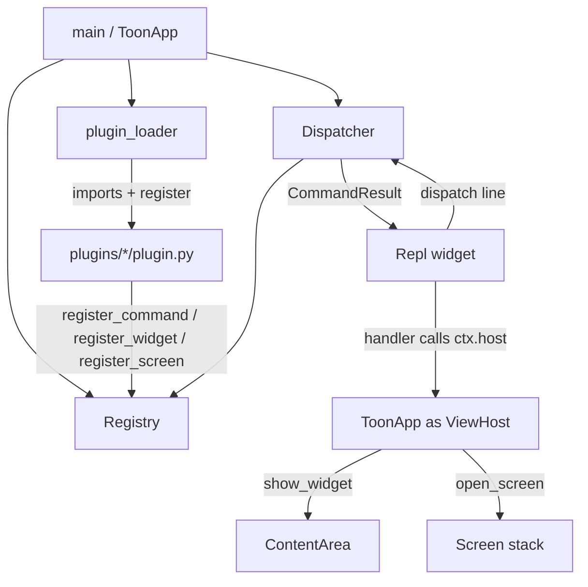

# Toon Developer Guide

How to extend **Toon** — add plugins, commands, widgets, and screens, and work
with the UI. This guide is a practical companion to [roadmap.md](roadmap.md)
(the project's intent and milestones) and
[docs/architecture.md](docs/architecture.md) (the frozen contracts).

---

## 1. What this project is

Toon is a **minimal [Textual](https://textual.textualize.io/) plugin runner** —
an *architecture proof*, not a general-purpose framework. It demonstrates one
idea:

> A host application discovers local extensions, lets them register commands and
> UI contributions, and wires those contributions to an interactive REPL and the
> main Textual interface.

Key facts to keep in mind while developing:

- **Plugins are trusted, in-process Python.** There is no sandbox, no hot
  reload, no process isolation, and no entry-point/package discovery.
- Plugins talk to the host through **one public module only**:
  [`toon.api`](src/toon/api/extension.py). Never import host internals from a
  plugin.
- Python **>= 3.13** is required. Dependencies are `textual` and `pydantic`.

---

## 2. Project layout at a glance

```text
src/toon/
  app.py                  # ToonApp: owns the App, layout, REPL, and ViewHost
  style.tcss              # Textual CSS for the UI
  api/
    extension.py          # THE public plugin contract (frozen)
    __init__.py           # re-exports the api surface
  runtime/
    registry.py           # stores commands / screen factories / widget factories
    dispatcher.py         # parses a line and runs the matching command
    plugin_loader.py      # discovers and imports plugins/*/plugin.py
    builtins.py           # help, clear, plugins, echo
  ui/
    repl.py               # the interactive input/output pane
    content.py            # the host content area where widgets mount
plugins/
  hello/plugin.py         # text-only command example
  system_info/plugin.py   # slightly richer text command example
  ui_demo/plugin.py       # widget + screen contribution example
```

### How everything connects



Startup sequence (in `ToonApp.__init__`, see [src/toon/app.py](src/toon/app.py)):

1. Create the `Registry`.
2. Register **built-ins first** (`help`, `clear`, `plugins`, `echo`) so a plugin
   can never shadow them.
3. Scan `plugins/` and load each `plugin.py`, isolating per-plugin failures.
4. Build the `Dispatcher` over the now-populated registry.
5. `compose()` mounts a `ContentArea` (top) and a `Repl` (bottom).

---

## 3. The public API you build against

Everything a plugin needs lives in [src/toon/api/extension.py](src/toon/api/extension.py)
and is re-exported from `toon.api`:

| Symbol | What it is |
| --- | --- |
| `Command(name, handler, description="")` | A REPL command. |
| `CommandContext(args, host)` | Passed to every handler. `args` are parsed tokens; `host` is the `ViewHost`. |
| `CommandHandler` | `Callable[[CommandContext], str \| None \| Awaitable[str \| None]]` — sync or async. |
| `CommandResult` | The dispatcher's return type (you rarely build this yourself). |
| `ExtensionRegistry` | The object passed to your `register()` function. |
| `ViewHost` | Navigation surface: `open_screen`, `show_widget`, `clear_output`. |
| `ScreenFactory` / `WidgetFactory` | `Callable[[], Screen]` / `Callable[[], Widget]`. |
| `RegistrationError` | Raised on duplicate or invalid names. |

**Handler rules:**

- Return a `str` to print output, or `None` for no output.
- May be `def` or `async def` — the dispatcher normalizes both.
- Never write to the REPL directly. Return text instead.
- Navigate only through `ctx.host`. Never reach into the app object.
- Exceptions are caught by the dispatcher and shown as errors — they won't crash
  the app, but return clean results where you can.

---

## 4. Adding a new plugin

A plugin is **an immediate child directory of `plugins/`** containing a
`plugin.py` with a module-level `register(registry)` function. The plugin's
**name is its directory name**. Discovery is sorted by directory name
(deterministic). No host code changes are needed — just drop the folder in.

### 4.1 Minimal text command

Create `plugins/greet/plugin.py`:

```python
from __future__ import annotations

from toon.api import Command, CommandContext, ExtensionRegistry


def greet(ctx: CommandContext) -> str:
    who = " ".join(ctx.args) if ctx.args else "stranger"
    return f"Greetings, {who}!"


def register(registry: ExtensionRegistry) -> None:
    registry.register_command(
        Command("greet", greet, description="Greet someone by name.")
    )
```

Run the app and type `greet Ada` → `Greetings, Ada!`. See
[plugins/hello/plugin.py](plugins/hello/plugin.py) and
[plugins/system_info/plugin.py](plugins/system_info/plugin.py) for the reference
text-only plugins.

### 4.2 Async command

Handlers can be `async def`; the dispatcher awaits them automatically:

```python
import asyncio

from toon.api import Command, CommandContext, ExtensionRegistry


async def slow_ping(ctx: CommandContext) -> str:
    await asyncio.sleep(1)
    return "pong"


def register(registry: ExtensionRegistry) -> None:
    registry.register_command(Command("ping", slow_ping, "Ping after a delay."))
```

Do **not** create a second event loop (`asyncio.run`, a new loop, etc.). Use
`await` directly — you are already inside Textual's loop.

### 4.3 Command arguments

Input is tokenized with `shlex.split` (quotes respected, no shell expansion,
no pipes or chaining). Your handler receives `ctx.args` as a `tuple[str, ...]`:

```python
# `mycmd "two words" flag` -> ctx.args == ("two words", "flag")
```

Parse `ctx.args` yourself for flags/options. Keep it simple — this is not a
shell.

---

## 5. Adding UI: widgets and screens

This is the "where do widgets load from" part. There are **two** kinds of UI
contribution, and both are registered as **factories** (zero-arg callables that
return a *fresh* Textual object each call).

### 5.1 The layout and where widgets mount

The base screen stacks two regions vertically (see
[src/toon/app.py](src/toon/app.py) `compose()`):

```text
┌─────────────────────────────┐
│  #content  (ContentArea)    │  ← widgets mount here
├─────────────────────────────┤
│  #repl     (Repl)           │  ← input + output log, always alive
└─────────────────────────────┘
```

- **Widgets** mount into the persistent `#content` area ("the grid" in the host
  UI), replacing whatever was there. The REPL stays usable. See
  [src/toon/ui/content.py](src/toon/ui/content.py).
- **Screens** are pushed onto Textual's screen stack as a full-screen view.
  `Escape` pops back to the REPL (host binding in
  [src/toon/app.py](src/toon/app.py), action `pop_view`).

The flow for a widget:

```
command handler  →  ctx.host.show_widget("name")
                 →  ToonApp.show_widget  (app.py)
                 →  Registry.create_widget("name")  → calls your factory
                 →  ContentArea.set_widget(widget)  → clears + mounts
```

### 5.2 Registering a widget and a screen

Full reference: [plugins/ui_demo/plugin.py](plugins/ui_demo/plugin.py). A
condensed template, `plugins/clock/plugin.py`:

```python
from __future__ import annotations

from textual.app import ComposeResult
from textual.containers import Vertical
from textual.screen import Screen
from textual.widgets import Static

from toon.api import Command, CommandContext, ExtensionRegistry

WIDGET_NAME = "clock_widget"
SCREEN_NAME = "clock_screen"


class ClockWidget(Vertical):
    def compose(self) -> ComposeResult:
        yield Static("I am a widget in the content area.")


class ClockScreen(Screen[None]):
    def compose(self) -> ComposeResult:
        yield Static("Full-screen view. Press Escape to return to the REPL.")


# Factories must return a FRESH instance every call.
def make_widget() -> ClockWidget:
    return ClockWidget()


def make_screen() -> ClockScreen:
    return ClockScreen()


def show_widget(ctx: CommandContext) -> str:
    ctx.host.show_widget(WIDGET_NAME)
    return f"Showing '{WIDGET_NAME}' in the content area."


def open_screen(ctx: CommandContext) -> str:
    ctx.host.open_screen(SCREEN_NAME)
    return "Opened the screen. Press Escape to return."


def register(registry: ExtensionRegistry) -> None:
    registry.register_widget(WIDGET_NAME, make_widget, description="A demo widget.")
    registry.register_screen(SCREEN_NAME, make_screen, description="A demo screen.")
    registry.register_command(Command("clock", show_widget, "Show the clock widget."))
    registry.register_command(Command("clock_full", open_screen, "Open the clock screen."))
```

**Rules that matter:**

- A factory **must not** return an already-mounted widget/screen. Build a new
  one each call — Textual cannot mount the same instance twice.
- Commands, screens, and widgets have **independent namespaces**, so a command
  and a widget may share a name (as `ui_demo` does with `demo_widget`).
- Navigation is **only** through `ctx.host`. There is intentionally no second
  path, and the host never special-cases plugin names.

### 5.3 Clearing / resetting the content area

The content area starts with a placeholder message (`ContentArea.show_message`).
`show_widget` replaces its contents. There's no public "clear the content area"
command yet — add one in your plugin by mounting a blank/placeholder widget if
you need it.

---

## 6. Manipulating the UI (styling and behavior)

### 6.1 Styling with Textual CSS

The app loads [src/toon/style.tcss](src/toon/style.tcss) via
`ToonApp.CSS_PATH`. Style by widget `id`, type, or class:

```css
#content {
    background: #161b22;
    border: solid #30363d;
}
#content:focus-within {
    border: solid #58a6ff;
}
```

To style your own plugin widget, give its children stable `id`s (the `ui_demo`
widgets use `id="ui-demo-widget-title"` etc.) and add rules to `style.tcss`, or
attach a `DEFAULT_CSS` string on your widget class to keep styling inside the
plugin:

```python
class ClockWidget(Vertical):
    DEFAULT_CSS = """
    ClockWidget {
        height: auto;
        padding: 1 2;
        border: round #58a6ff;
    }
    """
```

`DEFAULT_CSS` keeps a plugin self-contained; `style.tcss` is for host-wide
theming. The existing helper classes `.status-success`, `.status-running`, and
`.status-failed` are available for colored status text via Rich markup in
returned strings (e.g. return `"[green]done[/green]"`).

### 6.2 Output markup

The REPL log has `markup=True`, so returned strings may contain Rich/Textual
console markup: `return "[red]failed[/red]"`. Errors from the dispatcher are
already wrapped in red by the REPL.

### 6.3 Key bindings

Host-level bindings live in `ToonApp.BINDINGS` ([src/toon/app.py](src/toon/app.py)).
`Escape` is wired to `pop_view`. A **screen** you contribute can define its own
`BINDINGS` for keys that apply only while it is on top of the stack.

---

## 7. Adding a new built-in command

Built-ins are registered in
[src/toon/runtime/builtins.py](src/toon/runtime/builtins.py) by
`register_builtins`, which the app calls **before** loading plugins. Add one
there if it should always exist and be un-shadowable:

```python
def _now(ctx: CommandContext) -> str:
    from datetime import datetime
    return datetime.now().isoformat(timespec="seconds")


def register_builtins(registry: Registry, *, plugins=tuple) -> None:
    ...
    registry.register_command(Command("now", _now, "Show the current time."))
```

`help` is generated from the registry, so new commands appear automatically.
Prefer a **plugin** over a built-in unless the command is core host behavior.

---

## 8. Error handling behavior

- **Plugin load failures** (bad import, no `register`, exception during
  `register`) are caught per plugin in
  [src/toon/runtime/plugin_loader.py](src/toon/runtime/plugin_loader.py). One
  broken plugin never stops the others or the host. Failures are reported in the
  REPL at startup and via the `plugins` command.
- **Command failures** are caught in
  [src/toon/runtime/dispatcher.py](src/toon/runtime/dispatcher.py) and returned
  as `CommandResult.error`; the app never crashes on a handler exception.
- **Registration failures** (duplicate/invalid name) raise `RegistrationError`.
  Names must match `^[A-Za-z][A-Za-z0-9_-]*$`.

Do not swallow exceptions silently in your own code — return a clear message.

---

## 9. Running, testing, and quality

> The project uses [`uv`](https://docs.astral.sh/uv/). Equivalent `pip`/venv
> commands work too.

```bash
# Install deps (incl. dev group)
uv sync

# Run the app
uv run toon
# or
uv run python -m toon.app   # via the console script 'toon'

# Point at a different plugins directory
TOON_PLUGINS_DIR=/path/to/plugins uv run toon

# Lint / format
uv run ruff check .
uv run ruff format .

# Tests (pytest + pytest-asyncio, asyncio_mode=auto)
uv run pytest
```

### Testing your plugin

Keep registry/dispatcher tests independent of Textual; use Textual's test
harness only for UI flows.

```python
import asyncio

from toon.runtime.registry import Registry
from toon.runtime.dispatcher import Dispatcher
from toon.api import CommandContext

class _FakeHost:  # minimal ViewHost
    def open_screen(self, name): ...
    def show_widget(self, name): ...
    def clear_output(self): ...


def test_greet():
    reg = Registry()
    import plugins.greet.plugin as p   # or import via the loader
    p.register(reg)
    disp = Dispatcher(reg)
    result = asyncio.run(disp.dispatch("greet Ada", host=_FakeHost()))
    assert result.ok
    assert "Ada" in result.output
```

For UI, use `ToonApp.run_test()` (Textual's async pilot) to mount the app, send
input to the REPL, and assert on the content area / screen stack.

---

## 10. Checklist for a new contribution

- [ ] New plugin lives in `plugins/<name>/plugin.py` with a `register(registry)`
      function.
- [ ] Imports come **only** from `toon.api` (plus `textual` for UI).
- [ ] No host internals imported; navigation uses `ctx.host` only.
- [ ] Widget/screen factories return a **fresh** instance each call.
- [ ] Names are valid (`^[A-Za-z][A-Za-z0-9_-]*$`) and unique within their kind.
- [ ] Handlers return `str`/`None` and never write to the REPL directly.
- [ ] No second asyncio event loop.
- [ ] Added/updated tests; `ruff check` and `pytest` pass.

---

## 11. Where to look for examples

| You want to… | Read |
| --- | --- |
| Simplest possible command | [plugins/hello/plugin.py](plugins/hello/plugin.py) |
| A richer text command | [plugins/system_info/plugin.py](plugins/system_info/plugin.py) |
| A widget **and** a screen + commands | [plugins/ui_demo/plugin.py](plugins/ui_demo/plugin.py) |
| The frozen contract | [src/toon/api/extension.py](src/toon/api/extension.py) |
| How the host wires it all | [src/toon/app.py](src/toon/app.py) |
| Built-in commands | [src/toon/runtime/builtins.py](src/toon/runtime/builtins.py) |
| Where widgets mount | [src/toon/ui/content.py](src/toon/ui/content.py) |
| The REPL | [src/toon/ui/repl.py](src/toon/ui/repl.py) |
| Project intent & milestones | [roadmap.md](roadmap.md) |
| Frozen architecture decisions | [docs/architecture.md](docs/architecture.md) |
